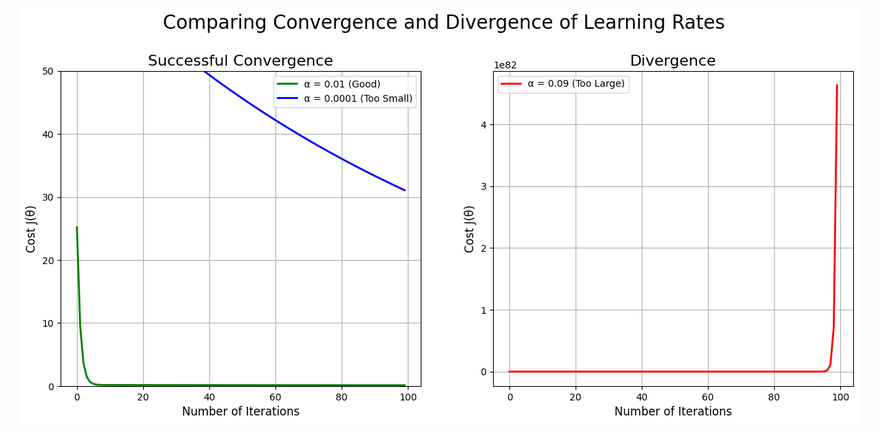
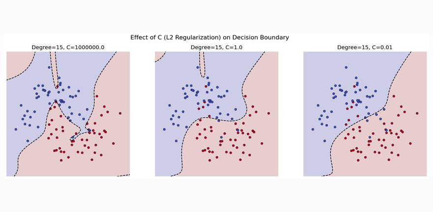
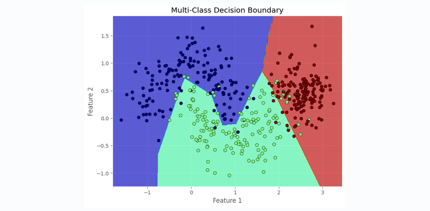
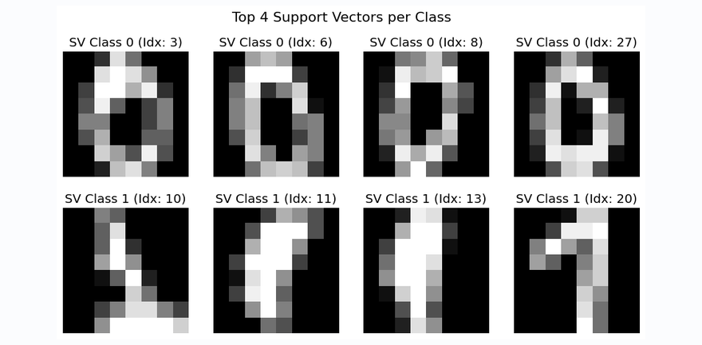
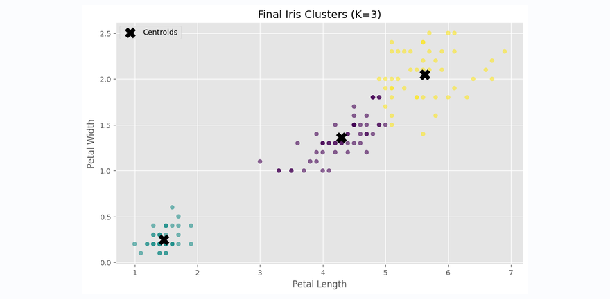
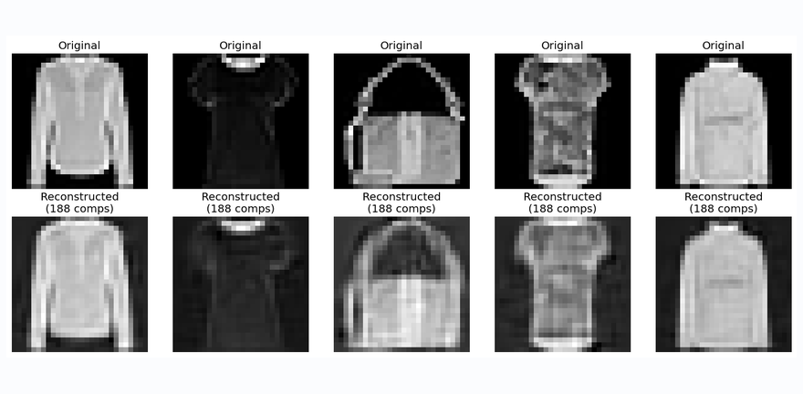

# Machine Learning Exercises

*University of Isfahan · Seventh semester · Fall 2025*

Six assignments that pair Python experiments with worked theory solutions in Persian. Each preview comes from the notebook’s saved output.

<table>
<tr>
<td width="50%" valign="top">

<h3><a href="exercises/01-gradient-descent/">01 · Gradient descent</a></h3>

Fit a linear regression model at three learning rates, then compare gradient descent with the normal equation in the theory solution.

<a href="exercises/01-gradient-descent/notebook.ipynb">Python notebook</a> · <a href="exercises/01-gradient-descent/theory.pdf">Theory PDF</a>

</td>
<td width="50%" valign="top">

<h3><a href="exercises/02-logistic-regularization/">02 · Logistic regression and regularization</a></h3>

Use L2 regularization to control a polynomial decision boundary and compare how L1 and L2 affect logistic-regression coefficients.

<a href="exercises/02-logistic-regularization/notebook.ipynb">Python notebook</a> · <a href="exercises/02-logistic-regularization/theory.pdf">Theory PDF</a>

</td>
</tr>
<tr>
<td width="50%" valign="top">

<h3><a href="exercises/03-neural-networks/">03 · Neural networks in NumPy</a></h3>

Implement a multiclass network, then vary its activation function, hidden-layer width, and learning rate to see how the model changes.

<a href="exercises/03-neural-networks/notebook.ipynb">Python notebook</a> · <a href="exercises/03-neural-networks/theory.pdf">Theory PDF</a>

</td>
<td width="50%" valign="top">

<h3><a href="exercises/04-support-vector-machines/">04 · Support vector machines</a></h3>

Classify handwritten 0s and 1s with linear and RBF kernels, tune the RBF model with grid search, and inspect the support vectors.

<a href="exercises/04-support-vector-machines/notebook.ipynb">Python notebook</a> · <a href="exercises/04-support-vector-machines/theory.pdf">Theory PDF</a>

</td>
</tr>
<tr>
<td width="50%" valign="top">

<h3><a href="exercises/05-kmeans-image-compression/">05 · K-means and image compression</a></h3>

Implement K-means centroid updates, cluster Iris samples without their labels, and use a 24-color palette to reconstruct a photograph.

<a href="exercises/05-kmeans-image-compression/notebook.ipynb">Python notebook</a> · <a href="exercises/05-kmeans-image-compression/theory.pdf">Theory PDF</a>

</td>
<td width="50%" valign="top">

<h3><a href="exercises/06-pca-anomaly-detection/">06 · PCA and anomaly detection</a></h3>

Reconstruct Fashion-MNIST images with PCA and use reconstruction error to distinguish sneakers from the T-shirts used for training.

<a href="exercises/06-pca-anomaly-detection/notebook.ipynb">Python notebook</a> · <a href="exercises/06-pca-anomaly-detection/theory.pdf">Theory PDF</a>

</td>
</tr>
</table>

## About the files

The notebooks include the assignment prompts, implementations, figures, and short analyses. The theory PDFs contain the written solutions. The editable files, template, and original fonts are in [theory-source](theory-source/).
