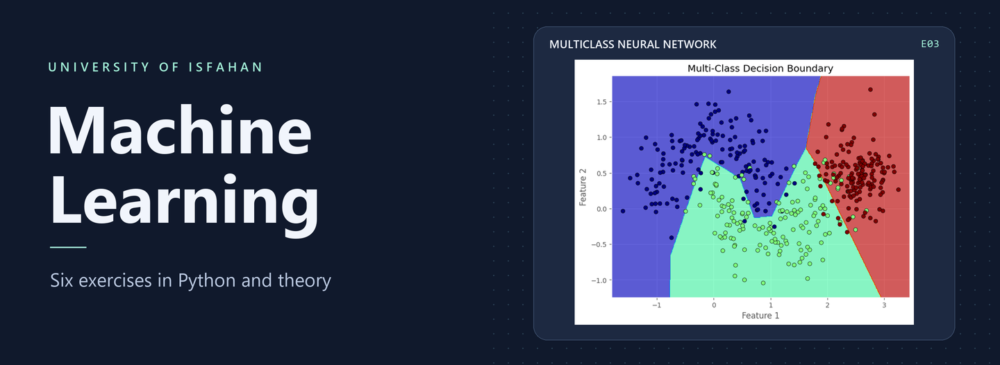
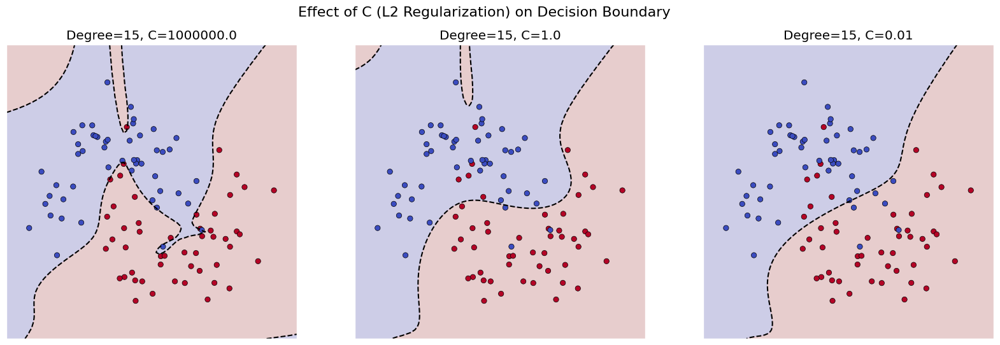
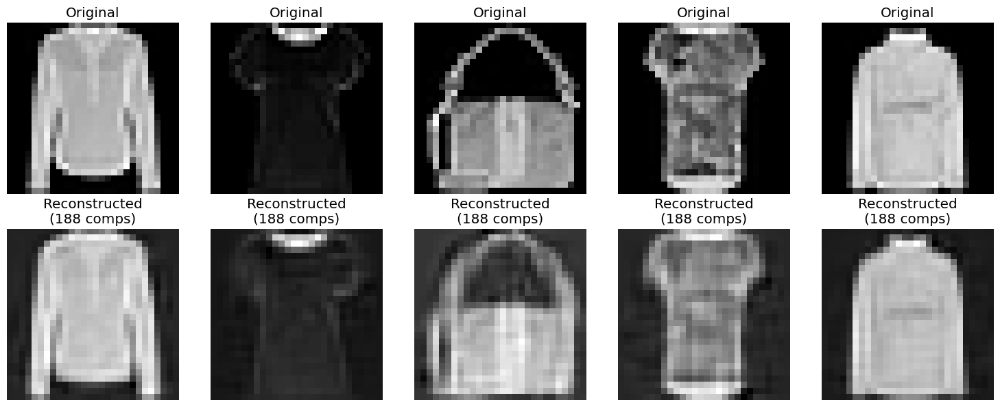
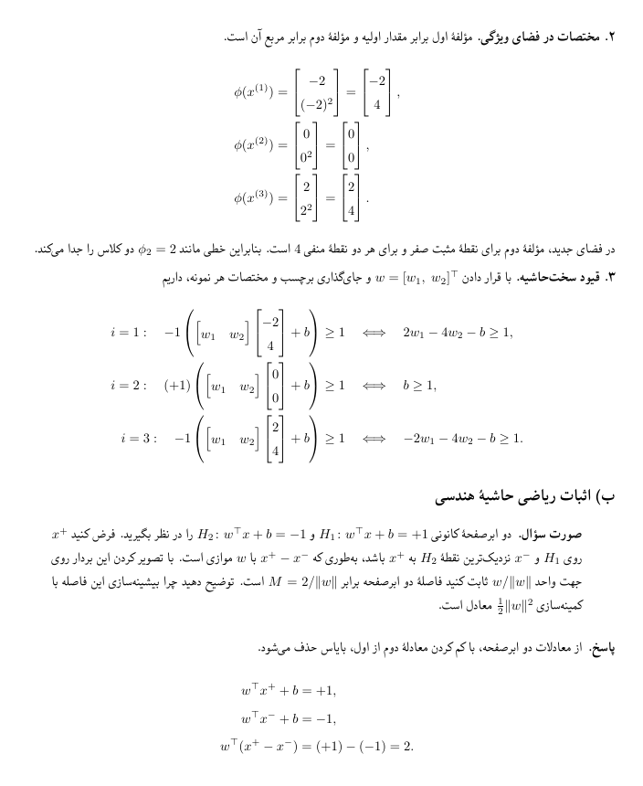

# Machine Learning Exercises

Six Machine Learning assignments from the University of Isfahan, with Python notebooks and worked theory solutions in Persian. The exercises move from gradient descent and regularization to neural networks, clustering, and anomaly detection.

[Exercise index](#exercise-index) · [Saved results](#saved-results) · [Run locally](#run-locally) · [Theory sources](#theory-sources)



## Exercise index

| Exercise | Practical work | Theory |
| --- | --- | --- |
| **01 · Gradient descent** | [Train linear regression at three learning rates](exercises/01-gradient-descent/notebook.ipynb) | [Gradient descent and the normal equation](exercises/01-gradient-descent/theory.pdf) |
| **02 · Logistic regularization** | [Compare nonlinear decision boundaries and L1/L2 coefficients](exercises/02-logistic-regularization/notebook.ipynb) | [Nonlinear features, regularization, and generalization](exercises/02-logistic-regularization/theory.pdf) |
| **03 · Neural networks** | [Build a multiclass network from scratch with NumPy](exercises/03-neural-networks/notebook.ipynb) | [Forward pass, cross-entropy, and backpropagation](exercises/03-neural-networks/theory.pdf) |
| **04 · Support vector machines** | [Classify handwritten 0s and 1s with linear and RBF SVMs](exercises/04-support-vector-machines/notebook.ipynb) | [Margins, feature maps, and the kernel trick](exercises/04-support-vector-machines/theory.pdf) |
| **05 · K-means** | [Cluster Iris samples and reduce an image to a 24-color palette](exercises/05-kmeans-image-compression/notebook.ipynb) | [Centroid updates, local minima, and clustering limits](exercises/05-kmeans-image-compression/theory.pdf) |
| **06 · PCA and anomaly detection** | [Reconstruct Fashion-MNIST images and score anomalies](exercises/06-pca-anomaly-detection/notebook.ipynb) | [Eigenvectors, explained variance, and anomaly evaluation](exercises/06-pca-anomaly-detection/theory.pdf) |

## Saved results

**Logistic regression · L2 regularization**

In exercise 02, lowering `C` strengthens regularization and smooths the decision boundary on the two-moons dataset.



**Principal component analysis · Image reconstruction**

The saved run for exercise 06 reconstructs five Fashion-MNIST samples using 188 principal components. Compare the original images in the top row with their reconstructions below.



## Run locally

The notebooks in exercises 01–05 were checked with Python 3.11. Their saved outputs can also be viewed directly on GitHub.

```bash
git clone https://github.com/HosnaSltn/Machine-Learning-Exercises.git
cd Machine-Learning-Exercises
python -m pip install -r requirements.txt
python -m jupyterlab
```

Open the notebook from the exercise index and run its cells in order. Exercise 06 downloads Fashion-MNIST through OpenML on the first run. [OpenML dataset](https://www.openml.org/d/40996)

## Theory sources

The six editable LaTeX solutions, shared template, and logo are in [`theory-source/`](theory-source/). The theory PDFs in the exercise index are ready to read. To rebuild a solution, use XeLaTeX with XePersian and an installed Persian font such as Amiri.

<p align="center">
  
</p>
